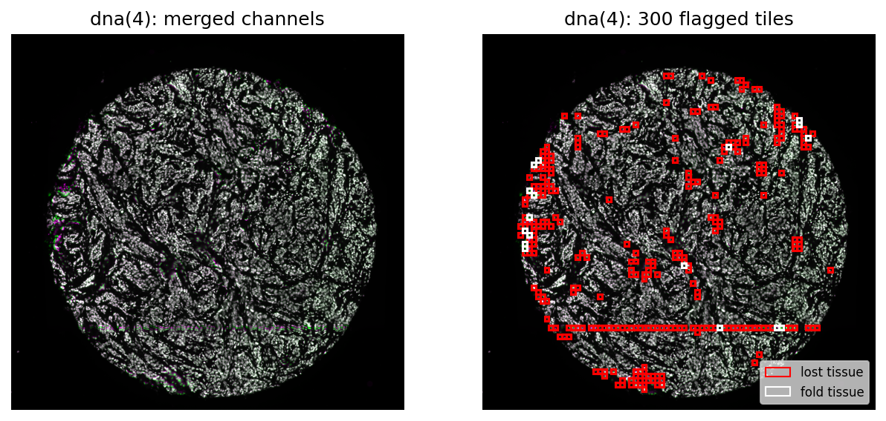
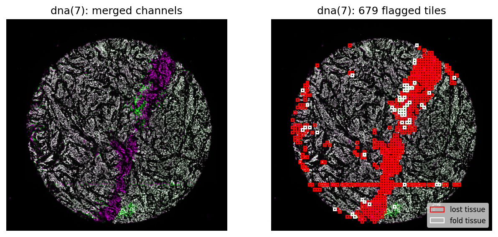

# mIF-Tissue-LostFold-Detection

Spatial proteomics (cyCIF) analysis of the tumor microenvironment in Invasive
Lobular Carcinoma (ILC) vs. Invasive Ductal Carcinoma/No-Special Type (NST)
breast cancer, correlated against tumor proliferation.

This repo currently focuses on a QC step that the full analysis depends on:
automatically detecting tissue that is **lost or folded** across the
multiple imaging rounds that cyCIF requires, before any biomarker
quantification is trusted.


## Background & motivation

Cyclic immunofluorescence (cyCIF) builds a multiplexed image by repeating,
over many rounds, a cycle of: stain &rarr; image &rarr; bleach. Every round
includes a DNA (Hoechst) counterstain, which is what ties the rounds
together — each round's DNA channel is registered back to the DNA channel
of round 0.

Cell **segmentation** is performed once, on round 0's DNA channel. Every
later round's biomarker signal (e.g., pRB, Ki67) is then quantified by
reusing that same round-0 mask: the mask is assumed to still line up with
real tissue in every later round.

The repeated wash/stain/bleach cycles are physically harsh on the tissue
section. Two failure modes break the round-0-mask assumption:

- **Tissue loss** — part of the section detaches or washes away in a later
  round, so the round-0 mask now points at empty slide where there used to
  be tissue.
- **Tissue fold** — part of the section folds over itself in a later round,
  so the round-0 mask now points at doubled/overlapping tissue instead of
  the single flat layer it was segmented on.

In both cases the later-round signal sampled through the round-0 mask is no
longer measuring the same physical tissue the mask was drawn on. This shows
up as noise that is indistinguishable from true biological signal unless it
is flagged explicitly — a proliferation score computed on a folded or lost
region is not a biology result, it's an artifact. Since the downstream goal
of this project is to correlate tumor microenvironment composition with
proliferation, any unflagged fold/loss region is a direct source of false
signal in that correlation. Hence the need for a QC step, run before
quantification, that flags exactly which rounds and which regions of each
slide are unreliable.


## Dataset

- **Source**: [HTAN](https://humantumoratlas.org/) (Human Tumor Atlas
  Network) breast cancer cyCIF collection.
- **Cohorts**:
  - NST (Invasive Ductal Carcinoma / No Special Type): 704 samples
  - ILC (Invasive Lobular Carcinoma): 147 samples
- **Format**: multi-round, multi-channel `.ome.tif`, one DNA (Hoechst)
  channel per round plus biomarker channels (including proliferation
  markers Ki67 and pRB).
- **Raw image locations** (not tracked in this repo): local desktop due to storage, will be uploaded


## Method

Implemented in [`notebook/qc_tissue_fold_lost.py`](notebook/qc_tissue_fold_lost.py)
(`QC_Fold_Lost` class), run in batch across a directory of `.ome.tif` files
by [`notebook/run_qc_batch.py`](notebook/run_qc_batch.py). For each slide,
every later round's DNA channel (the "candidate" round) is compared against
round 0's DNA channel (the reference round):

**Step 0 — whole-image gate (`global_disagreement`).** Compute
`1 - NCC` (normalized cross-correlation) over all foreground pixels at
once, where foreground is defined by an Otsu threshold on the reference
round. If this whole-image disagreement exceeds `GLOBAL_DISAGREE_THRESHOLD`
(0.7), the round is marked `registration_failed` and skipped straight to
manual review — per-tile scoring would be meaningless if most of the image
doesn't line up to begin with.

**Step 1 — per-tile disagreement (`tile_disagreement`).** Otherwise, the
image is split into a grid of `tile × tile` pixel blocks. For each tile:
- *Foreground check*: skip tiles where less than `min_foreground` (5%) of
  pixels exceed the Otsu threshold — too little tissue to judge.
- *NCC per tile*: the same `1 - NCC` calculation as the global check, but
  restricted to this one tile → `disagree[r, c]`.
- *Signed intensity change*: `dmean[r, c] = mean(tile_b) - mean(tile_a)` —
  the sign distinguishes gain vs. loss (positive = candidate round brighter
  than reference → potential fold/doubled tissue; negative = candidate
  round dimmer → potential tissue loss).

**Step 2 — flagging (`flag_folds`).** Tiles are flagged as outliers using
robust statistics (`median + k · MAD` of that round's own valid tile
`disagree` values, not mean/std, which are sensitive to the outliers
themselves). A tile is flagged if `disagree` is a spatial outlier
(`> median + k · MAD`), then split by the sign of `dmean`:
- `dmean > 0` → fold candidate (`fold_tile`)
- `dmean < 0` → lost tissue (`lose_tile`)

**Step 3 — export for downstream use.**
- `get_flagged_tile_bounds()` converts each flagged `(row, col)` tile into
  a pixel bounding box `(x0, y0, x1, y1)`, used later to exclude cells
  whose centroids fall inside.
- `get_qc_record()` summarizes the round: flagged-tile ratio (denominator =
  only tissue-containing tiles, not background), plus a `warning` field
  escalating from `PASS` → `Flag manually check` (ratio > 10%) →
  `Majority is lost/fold - Manual review` (whole-round registration
  failure).
- `plot_flagged_tiles()` renders a magenta/green merge (reference vs.
  candidate round) with red/white rectangles marking lost/fold tiles
  respectively, for visual QC.


## Results

Example output for one HTAN sample, `LSP12021-C10.ome.tif`, run with
`tile=32`, `min_foreground=0.05`, `k=8` (the `run_qc_batch.py` defaults).
Each row is one later round (`dna(2)`–`dna(10)`) compared back to round 0;
full table in
[`result/LSP12021-C10_qc.csv`](result/LSP12021-C10_qc.csv), flagged-tile
bounding boxes in
[`result/LSP12021-C10_flagged_bounds.csv`](result/LSP12021-C10_flagged_bounds.csv).

| round_dna | global_disagree | n_flagged_tiles | total_tiles | flagged_ratio | warning |
|---|---|---|---|---|---|
| dna(2)  | 0.134 | 131 | 3931 | 3.3%  | PASS |
| dna(3)  | 0.123 | 169 | 3931 | 4.3%  | PASS |
| dna(4)  | 0.164 | 300 | 3931 | 7.6%  | PASS |
| dna(5)  | 0.205 | 302 | 3931 | 7.7%  | PASS |
| dna(6)  | 0.196 | 351 | 3931 | 8.9%  | PASS |
| dna(7)  | 0.406 | 679 | 3931 | 17.3% | Flag manually check |
| dna(8)  | 0.550 | 679 | 3931 | 17.3% | Flag manually check |
| dna(9)  | 0.558 | 487 | 3931 | 12.4% | Flag manually check |
| dna(10) | 0.691 | 0   | 3931 | 0.0%  | PASS |

A few things stand out:
- Flagged-tile ratio and `global_disagree` climb together through the
  cycle (dna(2) → dna(9)): later rounds drift further from round 0, which
  is consistent with cumulative physical damage over repeated
  wash/stain/bleach cycles rather than a one-off registration glitch.
- `dna(10)`'s `global_disagree` (0.691) is the highest of all rounds, yet
  it has 0 flagged tiles and reads `PASS` — it's sitting right under the
  0.7 `GLOBAL_DISAGREE_THRESHOLD` gate, which shows the gate's binary cutoff
  can undersell a round that's quietly closer to registration failure than
  its flagged-tile count alone suggests.
- `dna(7)` and `dna(8)` flag the identical 679 tiles — the fold/loss region
  introduced at round 7 persists unchanged into round 8 rather than
  recovering or growing further.

`plot_flagged_tiles()` output for two of these rounds — red outlines are
lost-tissue tiles, white outlines are fold candidates, overlaid on a
round-0 (magenta) vs. candidate-round (green) merge:

**dna(5)** — moderate drift, `PASS` (7.7% flagged):


**dna(8)** — a large contiguous fold/loss band, `Flag manually check` (17.3% flagged):



## uv cheat sheet

[uv](https://docs.astral.sh/uv/) manages the Python version, virtual
environment, and dependencies together.

```bash
# Create/refresh the .venv from pyproject.toml + uv.lock
uv sync

# Add a runtime dependency (writes to pyproject.toml and uv.lock)
uv add <package>

# Add a dev-only dependency
uv add --dev <package>

# Remove a dependency
uv remove <package>

# Run a command inside the project's venv without activating it
uv run <command>
uv run python some_script.py
uv run pytest examples/

# Activate the venv directly (optional; uv run usually makes this unnecessary)
source .venv/bin/activate

# Upgrade all locked dependencies
uv lock --upgrade

# Pin/change the Python version this project uses
uv python pin 3.12
```

`.python-version` pins the interpreter version; `uv.lock` pins exact
dependency versions and should be committed. `.venv/` is git-ignored and
disposable — delete it and re-run `uv sync` any time.
